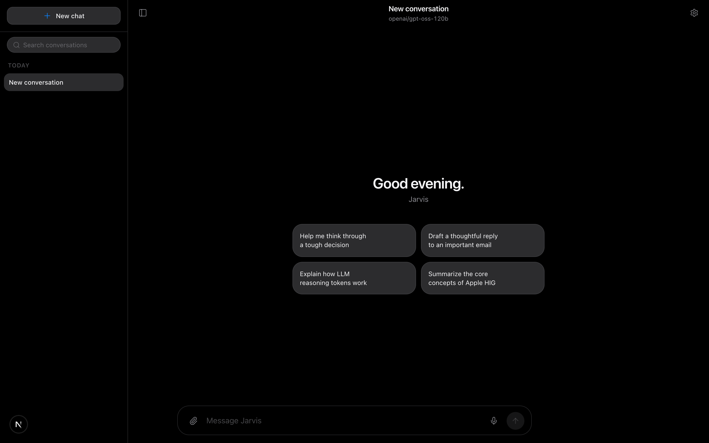

# Jarvis — Personal AI Chat Agent

A native-feeling personal AI assistant designed with Apple-level taste and restraint: calm, fast, quiet, and intentional. Every pixel carries meaning.



---

## Design Principles

- **Content first, chrome second**: No decoration that does not carry semantic meaning. Visual hierarchy is achieved through spacing, weight, and opacity, not borders, heavy shadows, or boxes.
- **Single accent color**: System blue (`#007AFF` in light, `#0A84FF` in dark) used strictly for interactive elements: user bubble, send button, focus rings, links, and selection. Zero gradients.
- **True black dark canvas**: `#000000` main canvas with elevated surfaces (`#1C1C1E`, `#2C2C2E`) and subtle hairline borders (`0.5px`, separator color).
- **Continuous corner feel**: Generous border radii (24px composer, 20px bubble/cards/dialogs, 12px buttons) with spring-physics motion (`stiffness ~400, damping ~34`).
- **Quiet typography**: System font stack (`-apple-system`, `SF Pro`, fallback `Inter`), semibold headings (600, never bold 700+), slightly negative letter spacing on display text, and tabular numbers across all UI data.
- **Zero emojis in UI chrome**: Thin-stroke SF Symbols weight (1.5 stroke width, 16–18px) iconography only.

---

## Features

1. **Streaming Chat with Abort & Thinking States**: Incremental SSE token rendering with pre-token pulsing indicators, Esc/button response cancellation, and instant retry.
2. **Conversation Management**: Grouped by Pinned, Today, Yesterday, Previous 7 days, and Older. Inline renaming, pinning, search, and deletion with undo toast notifications.
3. **Multi-Provider LLM Abstraction**: Server-side adapters for Google Gemini, Anthropic Claude, and any OpenAI-compatible streaming endpoint (Ollama, LM Studio, Groq, OpenRouter, vLLM).
4. **Safe Markdown & Code Execution**: GitHub-flavored markdown with sanitized HTML, syntax-highlighted code blocks with 1.5s copy checkmarks, and horizontally scrolling tables.
5. **Message Interaction Row**: Quiet action row (copy, regenerate, edit-and-resend branching, speech synthesis read aloud).
6. **Command Palette (`⌘K`)**: Spotlight-style centered palette with fuzzy search for conversations, quick actions, model switching, and theme toggling.
7. **iOS-Style Settings Sheet**: Grouped controls for Theme, Model identifier, Temperature slider ("Precise" to "Creative"), Persona system prompt, Context length, and Data export (JSON/Markdown) & import.
8. **Client-Side Persistence**: Fast IndexedDB storage via `idb-keyval` for conversations with corrupted data tolerance, quota error guards, and localStorage for UI preferences.
9. **Voice Input & Speech Synthesis**: Web Speech API recognition with real-time waveform pulse, plus speech synthesis readout.
10. **Rich Attachments**: Image previews, text files, paste-from-clipboard, and drag-and-drop file upload with a clean drop overlay.
11. **Mobile & PWA Ready**: Visual viewport keyboard tracking without jump, safe-area inset protection, installable manifest, and standalone iOS capabilities.

---

## Quick Setup (Under 2 Minutes)

### 1. Clone & Install
```bash
cd jarvis
npm install
```

### 2. Configure Environment
Copy `.env.example` to `.env.local`:
```bash
cp .env.example .env.local
```

Edit `.env.local` to configure your preferred provider:

#### Option A: OpenAI-Compatible (Default / Groq / Ollama / OpenRouter)
```env
LLM_PROVIDER=openai-compatible
OPENAI_BASE_URL=https://api.openai.com/v1     # or https://api.groq.com/openai/v1, http://localhost:11434/v1
OPENAI_API_KEY=your_key_here                  # optional for local Ollama
OPENAI_MODEL=gpt-4o-mini                      # or llama-3.3-70b-versatile
```

#### Option B: Google Gemini
```env
LLM_PROVIDER=gemini
GEMINI_API_KEY=your_gemini_key_here
GEMINI_MODEL=gemini-2.0-flash
```

#### Option C: Anthropic Claude
```env
LLM_PROVIDER=anthropic
ANTHROPIC_API_KEY=your_anthropic_key_here
ANTHROPIC_MODEL=claude-sonnet-4-20250514
```

### 3. Run Development Server
```bash
npm run dev
```
Open [http://localhost:3000](http://localhost:3000) in your browser.

---

## Keyboard Shortcuts

| Shortcut | Description |
| :--- | :--- |
| `⌘ K` / `Ctrl K` | Open Spotlight Command Palette |
| `⌘ ⇧ O` / `Ctrl ⇧ O` | Start a new conversation |
| `⌘ B` / `Ctrl B` | Toggle conversation sidebar |
| `Esc` | Stop generating response / Close dialogs |
| `↑` | Edit last message (when composer is empty) |
| `Return` | Send message |
| `⇧ Return` | Insert newline in composer |

---

## Project Structure

```
jarvis/
├── app/
│   ├── api/chat/route.ts       # SSE streaming chat endpoint with Zod validation
│   ├── globals.css             # Tailwind layers and design tokens
│   ├── layout.tsx              # Root HTML layout, theme script, and PWA meta
│   └── page.tsx                # Client chat root with ErrorBoundary
├── components/
│   ├── ChatWindow.tsx          # Root orchestrator component
│   ├── CodeBlock.tsx           # Syntax-highlighted code block with copy state
│   ├── CommandPalette.tsx      # Spotlight-style ⌘K command modal
│   ├── Composer.tsx            # Floating composer with auto-grow & attachments
│   ├── EmptyState.tsx          # Time-based greeting with suggestion pills
│   ├── ErrorBoundary.tsx       # Calm crash recovery screen
│   ├── MarkdownRenderer.tsx    # Safe markdown with rehype-sanitize
│   ├── Message.tsx             # iMessage-styled user bubble and plain canvas agent text
│   ├── MessageActions.tsx      # Copy, regenerate, edit, read aloud actions
│   ├── MessageList.tsx         # Scrollable conversation container
│   ├── ScrollToBottom.tsx      # Floating jump-to-latest button
│   ├── SettingsSheet.tsx       # iOS Settings-style slide-over panel
│   ├── SetupScreen.tsx         # First-run onboarding when API key is missing
│   ├── Sidebar.tsx             # Collapsible 260px conversation sidebar
│   ├── ThemeProvider.tsx       # Light/Dark/System theme context
│   ├── Toast.tsx               # Non-disruptive undo toasts
│   └── TopBar.tsx              # Minimal header with inline title rename
├── hooks/
│   ├── useChat.ts              # SSE streaming, retry backoff, stop, and regenerate
│   ├── useKeyboardShortcuts.ts # Global keybinding registration
│   ├── useOnlineStatus.ts      # Online/offline network listener
│   ├── useScrollAnchor.ts      # Intelligent near-bottom scroll stickiness
│   ├── useStorage.ts           # IndexedDB conversation management & date grouping
│   ├── useVisualViewport.ts    # iOS virtual keyboard positioning
│   └── useVoice.ts             # Web Speech API recognition & speech synthesis
├── lib/
│   ├── env.ts                  # Zod environment variable parsing & key redaction
│   ├── rate-limit.ts           # In-memory token bucket rate limiter
│   ├── utils.ts                # cn, ID generation, greetings, and time formatting
│   ├── llm/
│   │   ├── types.ts            # Common provider interface & schemas
│   │   ├── gemini.ts           # Google Gemini direct SSE streaming adapter
│   │   ├── anthropic.ts        # Anthropic Claude direct SSE streaming adapter
│   │   ├── openai-compatible.ts# Generic OpenAI-compatible streaming adapter
│   │   └── index.ts            # LLM provider factory
│   ├── storage/
│   │   ├── types.ts            # Storage schemas and UI preferences
│   │   ├── indexeddb.ts        # IndexedDB storage provider with quota guards
│   │   └── index.ts            # Storage singleton factory
│   └── tokens/
│       └── index.ts            # Token estimation & context window trimming
├── styles/
│   └── tokens.css              # Single source of truth CSS custom properties
├── public/
│   ├── icons/                  # PWA and Apple touch icons
│   └── manifest.json           # Web app manifest
├── screenshots/                # Browser verification screenshots (375, 768, 1440)
└── vitest.config.ts            # Test suite configuration
```

---

## Testing

Run the full unit test suite:
```bash
npm test
```
Covers:
- OpenAI-compatible, Gemini, and Anthropic provider adapters and error classification (401, 403, 404, 429).
- Token estimation and context window budget trimming.
- In-memory token bucket rate limiting.
- IndexedDB storage persistence, search, export/import, and UI preferences.

---

## Deploying to Vercel via GitHub

1. Push your repository to GitHub:
   ```bash
   git init
   git add .
   git commit -m "feat: initial commit of Jarvis AI chat agent"
   git remote add origin https://github.com/your-username/jarvis.git
   git push -u origin main
   ```
2. Import the project in [Vercel](https://vercel.com/new).
3. In the **Environment Variables** section, add:
   - `LLM_PROVIDER`: `openai-compatible` (or `gemini` / `anthropic`)
   - `OPENAI_API_KEY`: Your secret key (or `GEMINI_API_KEY` / `ANTHROPIC_API_KEY`)
   - `OPENAI_BASE_URL`: (Optional) Custom endpoint URL if using Groq, OpenRouter, etc.
   - `OPENAI_MODEL`: (Optional) Desired model identifier
4. Click **Deploy**. Vercel will build and host your production instance with edge-ready streaming headers.

---

## Architectural Assumptions

1. **Storage Engine**: Used `idb-keyval` for lightweight IndexedDB persistence to avoid SQLite/WASM bundle overhead, abstracting all access behind `StorageProvider` for future cloud database swap-ins.
2. **Provider Abstraction**: Handled streaming through direct REST fetch + Server-Sent Events parsing rather than vendor SDKs to minimize bundle size, ensure complete control over HTTP headers, and eliminate SDK version mismatches.
3. **Error Classification**: Error responses strictly differentiate 401 (Authentication/Key invalid), 403 (Project permissions or region/free-tier constraints), 404 (Model or route not found), and 429 (Rate/quota limits) without ever leaking API keys in client messages.
